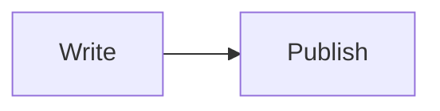

# Documents

Manage task descriptions, rich content, and document lists in Vaiz.

## Document Scopes

Vaiz supports three document scopes:

- **Space** - Shared documents accessible to all space members
- **Member** - Personal documents accessible only to the member
- **Project** - Project documents accessible to project members

## Get Documents List

Retrieve a list of documents by kind and ID:

```python
from vaiz.models import GetDocumentsRequest, Kind

# Get Space documents
space_docs = client.get_documents(
    GetDocumentsRequest(
        kind=Kind.Space,
        kind_id="space_id"
    )
)

# Get Member (personal) documents
member_docs = client.get_documents(
    GetDocumentsRequest(
        kind=Kind.Member,
        kind_id="member_id"
    )
)

# Get Project documents
project_docs = client.get_documents(
    GetDocumentsRequest(
        kind=Kind.Project,
        kind_id="project_id"
    )
)

# Process documents
for doc in project_docs.payload.documents:
    print(f"Document: {doc.title}")
    print(f"  ID: {doc.id}")
    print(f"  Size: {doc.size} bytes")
    print(f"  Creator: {doc.creator}")
    print(f"  Created: {doc.created_at}")
    print(f"  Kind: {doc.kind}")
    print(f"  Followers: {doc.followers}")
```

See [API Reference](../api-reference/documents) for complete Document model definition.

## Creating Documents

You can create new documents in any scope (Space, Member, or Project):

```python
from vaiz.models import CreateDocumentRequest, Kind

# Create a Project document
new_doc = client.create_document(
    CreateDocumentRequest(
        kind=Kind.Project,
        kind_id="project_id",
        title="Project Documentation",
        index=0,  # Position in document list
        parent_document_id=None  # Optional: for nested documents
    )
)

document = new_doc.payload.document
print(f"Created document: {document.id}")
print(f"Title: {document.title}")
```

### Creating Documents in Different Scopes

```python
# Space document (shared across organization)
space_doc = client.create_document(
    CreateDocumentRequest(
        kind=Kind.Space,
        kind_id=space_id,
        title="Company Wiki",
        index=0
    )
)

# Member document (personal)
personal_doc = client.create_document(
    CreateDocumentRequest(
        kind=Kind.Member,
        kind_id=member_id,
        title="My Notes",
        index=0
    )
)

# Project document
project_doc = client.create_document(
    CreateDocumentRequest(
        kind=Kind.Project,
        kind_id=project_id,
        title="Project Plan",
        index=0
    )
)
```

### Create and Populate Document

```python
# 1. Create document
response = client.create_document(
    CreateDocumentRequest(
        kind=Kind.Project,
        kind_id="project_id",
        title="Meeting Notes",
        index=0
    )
)

doc_id = response.payload.document.id

# 2. Add content
content = """
# Meeting Notes

**Date**: 2025-10-21

## Attendees
- John Doe
- Jane Smith

## Discussion
[Meeting content here]
"""

client.replace_markdown_document(doc_id, content)
print(f"✅ Document created and populated: {doc_id}")
```

### Creating Document Hierarchies

Create nested document structures for better organization:

```python
# 1. Create parent document
parent = client.create_document(
    CreateDocumentRequest(
        kind=Kind.Project,
        kind_id=project_id,
        title="Product Documentation",
        index=0
    )
).payload.document

# 2. Create child documents
child1 = client.create_document(
    CreateDocumentRequest(
        kind=Kind.Project,
        kind_id=project_id,
        title="Getting Started",
        index=0,
        parent_document_id=parent.id  # Link to parent
    )
).payload.document

child2 = client.create_document(
    CreateDocumentRequest(
        kind=Kind.Project,
        kind_id=project_id,
        title="API Reference",
        index=1,
        parent_document_id=parent.id  # Same parent
    )
).payload.document

# 3. Create nested child (grandchild)
grandchild = client.create_document(
    CreateDocumentRequest(
        kind=Kind.Project,
        kind_id=project_id,
        title="Quick Start Guide",
        index=0,
        parent_document_id=child1.id  # Nested under child1
    )
).payload.document

print(f"Created hierarchy: {parent.title} -> {child1.title} -> {grandchild.title}")
```

### Multi-Level Structure Example

```python
# Build a complete documentation tree
def create_doc_tree(client, project_id):
    """Create a hierarchical documentation structure."""
    
    # Root
    root = client.create_document(
        CreateDocumentRequest(
            kind=Kind.Project,
            kind_id=project_id,
            title="User Manual",
            index=0
        )
    ).payload.document
    
    # Chapters
    chapters = [
        ("Chapter 1: Introduction", ["Overview", "Installation", "Quick Start"]),
        ("Chapter 2: Features", ["Core Features", "Advanced Features"]),
        ("Chapter 3: Configuration", ["Basic Setup", "Advanced Settings"])
    ]
    
    for chapter_idx, (chapter_title, sections) in enumerate(chapters):
        # Create chapter
        chapter = client.create_document(
            CreateDocumentRequest(
                kind=Kind.Project,
                kind_id=project_id,
                title=chapter_title,
                index=chapter_idx,
                parent_document_id=root.id
            )
        ).payload.document
        
        print(f"📖 {chapter.title}")
        
        # Create sections
        for section_idx, section_title in enumerate(sections):
            section = client.create_document(
                CreateDocumentRequest(
                    kind=Kind.Project,
                    kind_id=project_id,
                    title=section_title,
                    index=section_idx,
                    parent_document_id=chapter.id
                )
            ).payload.document
            
            print(f"  📄 {section.title}")
    
    return root

# Create the tree
root_doc = create_doc_tree(client, project_id)
print(f"\n✅ Created documentation tree with root: {root_doc.id}")
```

## Editing Documents

Update document metadata such as title:

```python
from vaiz.models import EditDocumentRequest

# Edit document title
response = client.edit_document(
    EditDocumentRequest(
        document_id="document_id",
        title="Updated Document Title"
    )
)

edited_doc = response.payload.document
print(f"✅ Updated document: {edited_doc.title}")
```

### Complete Edit Workflow

Create, edit, and verify document changes:

```python
from vaiz import CreateDocumentRequest, EditDocumentRequest, GetDocumentsRequest, Kind

# 1. Create document
create_response = client.create_document(
    CreateDocumentRequest(
        kind=Kind.Project,
        kind_id=project_id,
        title="Initial Title",
        index=0
    )
)

doc_id = create_response.payload.document.id
print(f"Created: {create_response.payload.document.title}")

# 2. Edit document title
edit_response = client.edit_document(
    EditDocumentRequest(
        document_id=doc_id,
        title="Updated Title"
    )
)

print(f"Updated: {edit_response.payload.document.title}")

# 3. Verify change in document list
docs = client.get_documents(
    GetDocumentsRequest(kind=Kind.Project, kind_id=project_id)
)

updated_doc = next((d for d in docs.payload.documents if d.id == doc_id), None)
if updated_doc:
    print(f"✅ Verified: {updated_doc.title}")
```

## Working with Document Content

Document content is written as **Markdown**. The server converts it to native editor blocks (headings, lists, tables, code blocks, checklists, mentions, callouts, and more), and you can read it back as Markdown. The same methods work for standalone documents and task descriptions.

See [Markdown Syntax](../api-reference/markdown-syntax) for the full dialect.

### Replace Content

```python
client.replace_markdown_document(
    document_id="document_id",
    markdown="# Title\n\nSome **bold** text\n\n- item 1\n- item 2"
)
```

**Use cases:**
- Generating reports and documentation programmatically
- Updating task descriptions
- Importing content from other systems
- Building document templates

### Append Content

Add content to the end of a document without removing what is already there - useful for logs, notes and incremental updates:

```python
client.append_markdown_document(
    document_id="document_id",
    markdown="---\n\n## Update #1\n\n**Status:** design completed\n\n- [x] Mockups\n- [ ] Review"
)
```

### Read Content

```python
markdown = client.get_markdown_document("document_id")
print(markdown)
```

Because reads return the same dialect you write, you can read a document, edit the string and write it back:

```python
markdown = client.get_markdown_document(doc_id)
client.replace_markdown_document(doc_id, markdown.replace("TODO", "DONE"))
```

### Rich Content Examples

**Tables and checklists:**

```python
client.replace_markdown_document(doc_id, """# Sprint Status

| Task | Assignee | Status |
| --- | --- | --- |
| API | John | Done |
| Docs | Jane | In progress |

## Checklist

- [x] Deploy API
- [ ] Deploy app
    - [ ] Smoke tests
""")
```

**Code and diagrams:**

````python
client.replace_markdown_document(doc_id, """# Snippets

```python
print("Hello, Vaiz!")
```


""")
````

**Collapsible sections, callouts and columns:**

```python
client.replace_markdown_document(doc_id, """:::callout{icon="Light" color="blue"}
Remember to review before publishing.
:::

:::details{summary="Details" open}
Hidden **content** goes here.
:::

:::columns
::col
Left column
::col
Right column
:::
""")
```

**Mentions** reference users, tasks, documents and milestones by ID:

```python
member_id = client.get_profile().profile.member_id

client.append_markdown_document(
    doc_id,
    f"Owner: @[Me](user:{member_id}), related task: @[Task](task:{task_id})"
)
```

**Images** are standalone image lines that point to a URL (for example the URL of an uploaded file):

```python
client.append_markdown_document(doc_id, "")
```

### Update a Project Document

```python
from vaiz.models import GetDocumentsRequest, Kind

# 1. Get all project documents
docs = client.get_documents(
    GetDocumentsRequest(
        kind=Kind.Project,
        kind_id="project_id"
    )
)

# 2. Find specific document
target_doc = next(
    (doc for doc in docs.payload.documents if doc.title == "Meeting Notes"),
    None
)

if target_doc:
    # 3. Read the current content
    current = client.get_markdown_document(target_doc.id)
    print(f"Current size: {target_doc.size} bytes")

    # 4. Replace it
    client.replace_markdown_document(target_doc.id, """# Meeting Notes - Updated

## Attendees
- John Doe
- Jane Smith

## Action Items
- [ ] Review design mockups
- [ ] Update documentation
""")
    print(f"✅ Updated: {target_doc.title}")
```

### Plain Text Methods

`replace_document` and `append_document` write plain text without any formatting. Prefer the Markdown methods above for anything beyond a single line:

```python
client.replace_document(document_id="document_id", description="New content here")
client.append_document(document_id="document_id", description="\n\nMore content")
```

### Raw Lexical JSON (Read Only)

For advanced cases you can read the raw editor tree with `get_json_document`. See the [API reference](../api-reference/documents#get_json_document) for the node types:

```python
content = client.get_json_document("document_id")
for block in content["root"]["children"]:
    print(block["type"])  # "heading", "paragraph", "list", "table", ...
```

JSON content cannot be written - use the Markdown methods for all writes.

## See Also

- [Tasks](./tasks) - Task operations and descriptions
- [Markdown Syntax](../api-reference/markdown-syntax) - Supported Markdown dialect
- [Documents API Reference](../api-reference/documents) - Methods and models
- [Comments](./comments) - Add comments to tasks and documents
- [Projects](./projects) - Project management

